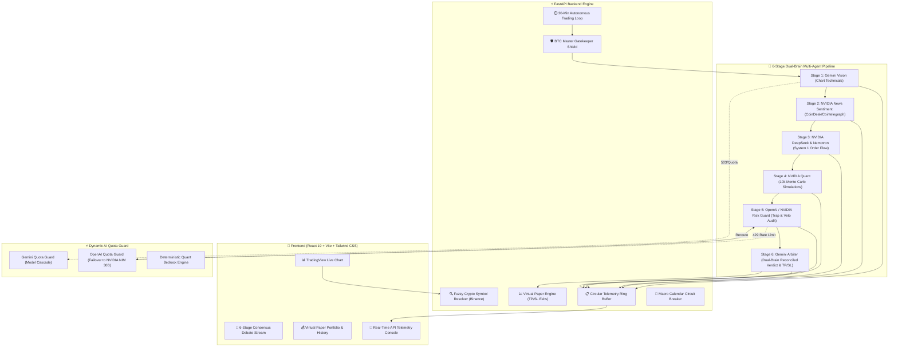

# 🤖 Crypto Bot — AetherTrade AI | Autonomous Dual-Brain Multi-Agent AI Crypto Trading Bot

> **The #1 Open-Source Autonomous AI Crypto Trading Bot & Consensus Terminal** powered by **NVIDIA NIM (DeepSeek & Nemotron Reasoning & Order Flow)**, **Google Gemini Vision**, **NVIDIA NIM Quantitative Stress Engine**, and **OpenAI Risk Guard with Instant NVIDIA NIM Failover**. Features **Dynamic AI Quota & Credit Circuit Breakers**, **6 Institutional Risk Safeguards**, **Derivatives Order Flow Calibration**, **Continuous AI Trade Learning Playbook**, **TradingView Charting**, **Live API Telemetry**, and a **Virtual Paper Trading Engine**.

[](https://github.com/swastik2012/Crypto-Bot)
[](https://build.nvidia.com)
[](https://python.org)
[](https://fastapi.tiangolo.com/)
[](https://react.dev/)
[](https://vitejs.dev/)
[](https://tradingview.com/)
[](LICENSE)

---

## 📌 Table of Contents
- [What is AetherTrade AI Crypto Bot?](#-what-is-aethertrade-ai-crypto-bot)
- [Why AetherTrade AI? (Comparison Matrix)](#-why-aethertrade-ai-comparison-matrix)
- [Key Features](#-key-features)
  - [1. 6-Stage Dual-Brain Multi-Agent Consensus](#1--6-stage-dual-brain-multi-agent-langgraph-consensus-engine)
  - [2. Intelligent AI Quota Guards & Automatic NVIDIA NIM Failover](#2--intelligent-ai-quota-guards--automatic-nvidia-nim-failover)
  - [3. 6 Institutional Risk Safeguards & Veto Engines](#3--6-institutional-risk-safeguards--veto-engines)
  - [4. Asymmetric Kelly Criterion Position Sizing](#4--asymmetric-kelly-criterion-position-sizing-engine)
  - [5. Chandelier Trailing Stop & Scale-Out Execution](#5--chandelier-trailing-stop--scale-out-execution)
  - [6. Continuous AI Trade Learner & Evolving Playbook](#6--continuous-ai-trade-learner--evolving-playbook)
  - [7. TradingView Terminal & Holographic HUD](#7--tradingview-advanced-chart--holographic-hud)
  - [8. Autonomous 30-Minute Auto-Trader Loop](#8--autonomous-30-minute-ai-auto-trader-loop)
  - [9. Virtual Paper Trading Engine (PnL Auditor)](#9--virtual-paper-trading-engine-pnl-auditor)
  - [10. Real-Time Telemetry & Diagnostics Console](#10--real-time-agent-telemetry--diagnostics-console)
- [Multi-Agent Architecture](#-multi-agent-architecture)
- [Quickstart: Local Installation & Setup](#-quickstart-local-installation--setup)
- [API Endpoints Reference](#-api-endpoints-reference)
- [Frequently Asked Questions (FAQ)](#-frequently-asked-questions-faq)
- [Recommended GitHub Topics & Tags](#-recommended-github-topics--tags)
- [License](#-license)

---

## 💡 What is AetherTrade AI Crypto Bot?

**AetherTrade AI** is a state-of-the-art, open-source **crypto bot** and automated **AI crypto trading bot** engineered to overcome the fatal failure modes of traditional single-indicator algorithms and hallucinatory single-prompt LLM bots.

Rather than relying on naive moving-average crossovers or isolated text prompts, AetherTrade AI orchestrates an **institutional 6-Stage Dual-Brain Multi-Agent Consensus Debate**:
1. **Gemini Vision**: Ingests candlestick charts to detect geometric patterns, key support/resistance levels, order blocks, and RSI divergences.
2. **NVIDIA News Sentiment**: Scrapes and analyzes live news from **CoinDesk**, **Cointelegraph**, and **CryptoSlate** to prevent trading against macro tides.
3. **NVIDIA DeepSeek / Nemotron (System 1 Microstructure)**: Fast quantitative reasoning over Binance perpetual futures funding rates, CVD divergence, and liquidation clusters.
4. **NVIDIA NIM Quant (Stress Test)**: Executes **10,000 Monte Carlo path simulations** conditioned on news-adjusted volatility to verify mathematical expectancy ($R:R \ge 2.0$).
5. **OpenAI Risk Guard with NVIDIA NIM Failover**: Acts as Chief Risk Officer & Devil's Advocate, auditing for liquidity traps, false breakouts, and predatory sweeps.
6. **Gemini Arbiter**: Reconciles System 1 priors with System 2 cross-examination to synthesize actionable execution plans (Entry, TP1, TP2, Stop-Loss).

Equipped with **automatic credit failover**, the bot never halts when API credits expire: if OpenAI or Gemini quotas are hit, tasks instantly cascade to **NVIDIA NIM flagship reasoning models** (`nvidia/nemotron-3.5-lightning-30b-a3b`) or local deterministic quantitative algorithms.

---

## 🏆 Why AetherTrade AI? (Comparison Matrix)

| Feature / Capability | Traditional Grid / DCA Bot | Single-Prompt AI Bot | ⚡ AetherTrade AI Crypto Bot |
| :--- | :---: | :---: | :---: |
| **System 1 Fast Reasoning & Order Flow** | ❌ None | ❌ None (high latency) | ✅ **NVIDIA DeepSeek & Nemotron CoT** |
| **Technical Vision Analysis** | ❌ None (lagging math only) | ❌ Text-only prompts | ✅ **Gemini Vision Multi-Timeframe Pattern Recognition** |
| **Live News Sentiment Scraping** | ❌ None | ❌ Outdated knowledge | ✅ **Real-Time CoinDesk, Cointelegraph & CryptoSlate** |
| **Quantitative Monte Carlo Proof** | ❌ None | ❌ None | ✅ **10,000-Path Mathematical Expectancy Engine** |
| **AI Quota & Credit Failover** | ❌ None | ❌ Crashes on HTTP 429 | ✅ **OpenAI & Gemini Quota Guards ➔ NVIDIA NIM Failover** |
| **BTC Gatekeeper (Altcoin Shield)** | ❌ Altcoins get crushed | ❌ Ignores market beta | ✅ **Instant Altcoin Long Veto when BTC Dumps** |
| **Liquidation Sweep Sniping** | ❌ Chases market tops | ❌ Market-order entries | ✅ **Wholesale Limit Orders at Liquidity Pool Discounts** |
| **Asymmetric Kelly Position Sizing** | ❌ Fixed static bet size | ❌ Random sizing | ✅ **Graded A+/A/B/C Sizing based on Expectancy & Confluence** |
| **Chandelier Trailing Stop** | ❌ Static stop-loss | ❌ Static stop-loss | ✅ **TP1 Break-Even Lock + Dynamic High-Water Ratchet** |
| **AI Trade Learning Playbook** | ❌ Repeats same mistakes | ❌ Zero memory | ✅ **Post-Mortem Trade Audits & Negative-Rule Vetoes** |
| **Hands-Free Auto-Trading Loop** | ⚠️ Blindly executes grids | ❌ Manual prompting | ✅ **Autonomous 30-Min Cycles with 5s Tick Engine** |
| **Virtual Paper Trading Engine** | ⚠️ Requires exchange keys | ❌ None | ✅ **$10k Virtual Capital Engine with Real PnL Audit** |
| **100% Free & Open-Source** | ❌ Monthly subscription fees | ❌ Paid SaaS wrapper | ✅ **100% Open-Source (MIT License)** |

---

## 🌟 Key Features

### 1. 🧠 6-Stage Dual-Brain Multi-Agent LangGraph Consensus Engine
- **Stage 1: Google Gemini Vision** — Ingests live candlestick chart structures, detecting ascending triangles, double bottoms, order blocks, and multi-timeframe key levels.
- **Stage 2: NVIDIA NIM News Sentiment** — Scrapes live RSS feeds from **CoinDesk**, **Cointelegraph**, and **CryptoSlate**, extracting a sentiment score (0–100%) and macro gist.
- **Stage 3: NVIDIA DeepSeek / Nemotron (System 1)** — Evaluates Binance perpetual futures funding rates, CVD divergence, and order flow microstructure.
- **Stage 4: NVIDIA NIM Quant (Stress Test)** — Executes **10,000 Monte Carlo path simulations** with news-weighted volatility adjustments and stress-testing.
- **Stage 5: OpenAI GPT-4o / NVIDIA NIM Risk Guard** — Audits false breakout probability, traps, liquidity sweep boundaries, and toxic predatory order flow.
- **Stage 6: Google Gemini Arbiter** — Synthesizes the final unified verdict (`STRONG BUY`, `BUY`, `HOLD`, `SELL`), entry price, TP1, TP2, and Stop-Loss.

### 2. ⚡ Intelligent AI Quota Guards & Automatic NVIDIA NIM Failover
- **OpenAI Quota Guard**: When OpenAI API keys return HTTP 429 (credits exhausted or rate-limited), a circuit breaker engages a 60-minute cooldown, routing all subsequent OpenAI tasks to **NVIDIA NIM** (`nvidia/nemotron-3.5-lightning-30b-a3b`) in **0.0 ms**.
- **Gemini Quota Guard**: Automatically cascades across Gemini models (`gemini-3.5-flash` ➔ `gemini-2.5-flash` ➔ `gemini-flash-lite-latest`) with model-level cooldown tracking.
- **Deterministic Bedrock**: If all external AI endpoints are unreachable, local algorithmic quantitative functions compute risk scores and trade grades without pipeline failure.
- **Universal LLM JSON Extractor**: Robustly parses responses across models, extracting structured JSON from standard `content`, internal `reasoning_content` chain-of-thought, or via regex fallback.

### 3. 🛡️ 6 Institutional Risk Safeguards & Veto Engines
1. **Multi-Timeframe Confluence (MTF)**: Audits 1D macro tide against 4H and 1H trends. Counter-trend setups against the 1D trend are heavily penalized or vetoed.
2. **Phase 2 BTC Master Gatekeeper (Altcoin Protection Shield)**: Live 1H/4H Bitcoin trend monitoring. If BTC is dumping below its 1H EMA50 with falling RSI, all altcoin long executions are immediately vetoed.
3. **Phase 3 Liquidation Sweep Sniping & Wholesale Limit Orders**: Rather than chasing market price, the engine calculates discount liquidity sweep zones to place wholesale limit orders.
4. **Phase 4 Funding Rate Arbitrage & Positive Carry Biasing**: Incorporates Binance perpetual 8-hour funding rates. Trades earning positive funding carry receive a conviction boost; trades paying heavy funding are penalized.
5. **Phase 5 Macro Economic Calendar & Volatility Circuit Breaker**: Evaluates upcoming Tier-1 and Tier-2 economic events (CPI, PPI, FOMC, NFP), enforcing trading lockouts or stop tightening around volatility spikes.
6. **Phase 6 AI Trade Learner Negative Rule Playbook**: Auto-evaluates setups against dynamically learned loss rules (`pb_001`, `pb_003`, `learn_001`) to prevent repeating past mistakes.

### 4. 📐 Asymmetric Kelly Criterion Position Sizing Engine
Allocates capital dynamically based on statistical edge and multi-timeframe alignment:
- **⭐ Grade A+ (Full Kelly 1.0x)**: 3/3 MTF confluence, win probability $\ge 75\%$, $R:R \ge 2.2$. Capital allocation up to **15%** of equity.
- **🔹 Grade A (Half-Kelly 0.50x)**: 2/3 MTF confluence, win probability $\ge 65\%$. Allocation capped at **9%** of equity.
- **🔸 Grade B (Quarter-Kelly 0.25x)**: Partial confluence, win probability $\ge 52\%$. Allocation capped at **4.5%** of equity.
- **⛔ Grade C (Vetoed 0.0x)**: Weak probability, negative mathematical expectancy, or macro misalignment. Zero capital allocated.

### 5. 🎯 Chandelier Trailing Stop & Scale-Out Execution
- **TP1 (Scale-Out 50%)**: When price hits Take-Profit 1, half the position is automatically locked in profit and the Stop-Loss is ratcheted to the break-even entry price.
- **TP2 Runner with Chandelier Trailing Stop**: The remaining runner position trails behind the dynamic high-water mark, maximizing profits during extended trends and closing automatically upon a retracement.

### 6. 📚 Continuous AI Trade Learner & Evolving Playbook
- Automatically audits completed paper trades post-mortem.
- Synthesizes actionable negative rules (e.g., vetoing long setups when 8h funding exceeds +0.035% or when CVD exhibits bearish exhaustion).
- Maintains agent accuracy scorecards for Gemini Vision, DeepSeek, and OpenAI Risk Guard.

### 7. 📊 TradingView Advanced Chart & Holographic HUD
- Official TradingView Advanced Chart widget with real-time price streaming for major cryptocurrency pairs.
- Holographic HUD overlays displaying active Entry, TP1, TP2, and Trailing Stop levels directly over the chart.

### 8. 🤖 Autonomous 30-Minute AI Auto-Trader Loop
- Periodically scans top crypto pairs (`BTC/USDT`, `ETH/USDT`, `SOL/USDT`, `AVAX/USDT`, `DOGE/USDT`).
- Pre-flight order flow filter screens out illiquid or toxic candidates before triggering multi-agent consensus.
- Background 5-second tick loop monitors open positions against live price streams for instant TP/SL execution.

### 9. 💰 Virtual Paper Trading Engine (PnL Auditor)
- $10,000 baseline virtual capital with 1-click portfolio reset.
- Live tracking of realized/unrealized PnL, isolated margin, open positions, and closed trade audit trails.

### 10. 📡 Real-Time Agent Telemetry & Diagnostics Console
- Live outbound LLM telemetry tracking round-trip latency (ms), HTTP status codes, tokens, and raw payloads.
- Filterable by provider (`Gemini`, `NVIDIA`, `OpenAI`, `News`, `Errors`) with a single-click buffer purge.

---

## 🏗️ Multi-Agent Architecture



---

## 🚀 Quickstart: Local Installation & Setup

### Prerequisites
- **Node.js**: v18.0+ or v20.0+
- **Python**: v3.10+ (or v3.11 / v3.12 / v3.14)
- **Git**

### Installation Steps

1. **Clone the repository**:
   ```bash
   git clone https://github.com/swastik2012/Crypto-Bot.git
   cd Crypto-Bot
   ```

2. **Install Frontend Dependencies**:
   ```bash
   npm install
   ```

3. **Install Backend Dependencies**:
   ```bash
   python3 -m venv backend/venv
   source backend/venv/bin/activate    # On Windows: backend\venv\Scripts\activate
   pip install -r requirements.txt
   ```

4. **Configure API Keys (Optional)**:
   > *Note: If API keys are omitted or credits are exhausted, the crypto bot automatically engages NVIDIA NIM failovers and deterministic mathematical algorithms with zero downtime.*
   
   Copy `.env.example` to `backend/.env`:
   ```bash
   cp backend/.env.example backend/.env
   ```
   Configure your keys in `backend/.env`:
   ```env
   # Google Gemini
   GEMINI_API_KEY=AIzaSy...
   GEMINI_MODEL=gemini-flash-lite-latest

   # NVIDIA NIM Models
   NVIDIA_API_KEY=nvapi-...
   NVIDIA_MODEL=nvidia/nemotron-3.5-lightning-30b-a3b
   NVIDIA_DEEPSEEK_MODEL=nvidia/nemotron-3.5-lightning-30b-a3b
   NVIDIA_REASONING_MODEL=nvidia/nemotron-3.5-lightning-30b-a3b
   NVIDIA_FLAGSHIP_MODEL=nvidia/nemotron-3.5-lightning-30b-a3b
   NVIDIA_RISK_MODEL=nvidia/nemotron-3.5-lightning-30b-a3b

   # OpenAI (Optional - automatically fails over to NVIDIA NIM when exhausted)
   OPENAI_API_KEY=sk-proj-...
   ```

5. **Start the Application in 1 Command**:
   ```bash
   ./start.sh
   # or
   npm start
   ```
   > 💡 *The script automatically verifies your environment, handles port conflicts, displays your local and mobile Wi-Fi URLs, and starts both the FastAPI backend and Vite frontend concurrently.*

6. Open your browser and navigate to **[http://127.0.0.1:5173](http://127.0.0.1:5173)**!

---

## 📡 API Endpoints Reference

| Method | Endpoint | Description |
| :--- | :--- | :--- |
| `GET` | `/health` | Health check endpoint confirming backend service status |
| `POST` | `/api/search-symbol` | Fuzzy crypto pair lookup with 24h Binance price/volume data |
| `POST` | `/api/analyze-and-trade` | Triggers the 6-Stage Multi-Agent Consensus debate pipeline |
| `GET` | `/api/analysis/latest/{symbol}` | Retrieves the latest cached multi-agent analysis for a symbol |
| `GET` | `/api/consensus/recent-signals` | Live multi-agent consensus signals feed with real-time PnL |
| `GET` | `/api/paper-trading/state` | Live virtual cash balance, open positions, unrealized & realized PnL |
| `POST` | `/api/paper-trading/order` | Executes a virtual paper trading market or limit order |
| `POST` | `/api/paper-trading/reset` | Resets paper portfolio back to $10,000 baseline capital |
| `GET` | `/api/paper-trading/learnings` | Retrieves persistent post-mortem AI trade learnings |
| `GET` | `/api/learning/summary` | Evolving playbook overview, audited trade count, and rule tally |
| `GET` | `/api/learning/playbook` | Active set of evolving trading rules and negative-rule vetoes |
| `GET` | `/api/learning/post-mortems` | Chronological list of AI post-mortems for winning/losing trades |
| `GET` | `/api/learning/scorecards` | Agent accuracy and reliability scorecards |
| `GET` | `/api/macro-calendar/status` | Macroeconomic circuit breaker status, lockout directives, upcoming CPI/FOMC |
| `GET` | `/api/macro-calendar/events` | Upcoming institutional macroeconomic event schedule |
| `GET` | `/api/forex/rates` | Real-time foreign exchange conversion rates |
| `GET` | `/api/auto-trader/status` | Current countdown and execution log for 30m auto-trading loop |
| `POST` | `/api/auto-trader/toggle` | Pauses or resumes the 30-minute auto-trading scheduler |
| `POST` | `/api/auto-trader/trigger-now` | Immediately triggers an on-demand consensus cycle |
| `GET` | `/api/telemetry/logs` | Real-time stream of outbound agent API calls with latency and payloads |
| `POST` | `/api/telemetry/clear` | Purges the telemetry diagnostics circular buffer |

---

## ❓ Frequently Asked Questions (FAQ)

### What is a crypto bot?
A crypto bot (cryptocurrency trading bot) is an automated software program that analyzes market conditions, price charts, order flow, and trading indicators to generate signals or automatically execute trades without requiring continuous manual human intervention.

### What happens when OpenAI or Gemini credits run out?
AetherTrade AI has built-in **AI Quota Guards**. If OpenAI credits are exhausted (HTTP 429), the circuit breaker triggers a 60-minute cooldown and immediately redirects all risk audit tasks to **NVIDIA NIM** (`nvidia/nemotron-3.5-lightning-30b-a3b`) in 0.0 ms. If all cloud LLMs are offline, the bot seamlessly executes deterministic mathematical algorithms, ensuring uninterrupted operation.

### How does the 6-stage consensus debate prevent false trades?
Unlike single-model bots that hallucinate on isolated indicators, AetherTrade AI requires cross-examination between technical vision (Gemini), macro news sentiment (NVIDIA), order flow microstructure (DeepSeek), mathematical Monte Carlo simulation (NVIDIA Quant), and a devil's advocate risk audit (OpenAI/NVIDIA Risk Guard). A trade is executed only when multi-agent conviction exceeds the threshold and passes all institutional veto filters.

### Can I run this crypto bot without risking real capital?
Yes! AetherTrade AI includes a built-in virtual paper trading engine initialized with $10,000 in simulated USDT capital. You can test strategies, monitor live win rates, and observe auto-trading executions risk-free.

### Is AetherTrade AI free to use?
Yes, the crypto bot is 100% free and open-source under the MIT License. You can clone, modify, and run it locally or deploy it on your own server.

### What cryptocurrency pairs are supported?
AetherTrade AI supports all major cryptocurrency pairs against USDT, including **Bitcoin (BTC/USDT)**, **Ethereum (ETH/USDT)**, **Solana (SOL/USDT)**, **Avalanche (AVAX/USDT)**, **Ripple (XRP/USDT)**, and **Dogecoin (DOGE/USDT)**, with fuzzy search powered by RapidFuzz.

---

## 🏷️ Recommended GitHub Topics & Tags

To maximize your repository's visibility in Google and GitHub search, add these topic tags in your GitHub repository settings:

```text
crypto-bot, ai-crypto-bot, crypto-trading-bot, trading-bot, cryptocurrency, bitcoin-bot, binance-bot, algorithmic-trading, automated-trading, langchain, langgraph, gemini-vision, deepseek, nvidia-nim, openai, fastapi, react-tradingview, paper-trading, quantitative-finance
```

---

## 📜 License

Distributed under the **MIT License**. See [`LICENSE`](LICENSE) for details.

---

<p align="center">
  <b>Built with ⚡ by AetherTrade AI — The Next-Gen Autonomous Crypto Bot</b>
</p>
